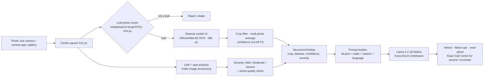

# IlaiNalam (இலைநலம், "leaf health") — offline crop-disease detection and advice on an Arm phone

**Bharat AI-SoC Challenge 2026–27 · Problem Statement 1: Offline Crop-Disease / Pest Detection & Advisory**

A farmer photographs a leaf. The phone finds the leaf, measures the diseased spots, names the disease and how urgent it is, then **Llama 3.2 1B, running on the phone through ExecuTorch**, explains what to do, in the farmer's language. Everything runs on the phone's Arm CPU. The app has **no internet permission**.

| | |
|---|---|
| Platform | Android 9+ (arm64-v8a), tested on Motorola Moto G34 5G (Snapdragon 695) and OPPO CPH2889 (MediaTek MT6835) |
| On-device AI | ExecuTorch 1.5.1 runtime, XNNPACK backend (Arm CPU, NEON-optimised kernels) |
| Vision | Leaf-photo check (MobileNetV3-Small FP32) + disease model v4 (EfficientNet-B2, INT8, 288 px) |
| Language model | Llama 3.2 1B-Instruct, 8-bit dynamic activations / 4-bit weights (8da4w), KV cache |
| Languages | English, हिंदी, தமிழ், മലയാളം, తెలుగు, ಕನ್ನಡ — interface, disease cards and read-aloud |
| Crops / classes | 14 crops, 38 classes (PlantVillage label set) |

---

## What the app does

1. **Capture.** A live camera with a guide frame shows hints ("too dark", "hold steady", "place one leaf in the frame") before the photo. The phone's camera app or the gallery also work. The farmer can say which crop it is, or "Not sure".
2. **Is this a crop leaf?** A small AI model rejects faces, walls, turf, objects and other non-leaf photos before any disease is named.
3. **Find the leaf and its spots.** Classic image processing separates the leaf from the background, removes shadows and measures the share of the leaf covered by spots. That share gives **severity**: Mild (< 10 %), Moderate (10–25 %) or Severe (> 25 %). The farmer can see exactly what was measured: *Photo / Leaf / Spots* views.
4. **Name the disease.** The INT8 disease model returns 38 probabilities. If the farmer chose a crop, only that crop's diseases are considered. Up to 3 photos of the same plant can be combined.
5. **Be honest about uncertainty.** Below 50 % confidence the app says "Could not identify", lists the possibilities and points to an expert instead of guessing a spray. Look-alike diseases get a "how to tell them apart" hint.
6. **Urgency and expert help.** Mild → check again in 3–4 days. Moderate → act this week. Severe → act today, plus a one-tap call to the **Kisan Call Centre (1800-180-1551)**.
7. **Advice.** Llama 3.2 1B writes the advice from a verified knowledge base (`kb.json`), the farmer's state and the current season (Kharif / Rabi / Zaid). In Hindi mode Llama answers in Hindi. In Tamil, Malayalam, Telugu and Kannada the pre-written disease card is shown and read aloud. Farmers can ask follow-up questions, or ask the general **farming advisor** without a photo. It never gives doses or brands and tells the farmer to confirm with the KVK.

## Architecture (two on-device pipelines)



Both pipelines run through ExecuTorch on the CPU with the XNNPACK delegate. The vision models and Llama share ExecuTorch's single thread pool, under one lock (see *Engineering notes*).

## Results

### Disease model (38 classes)

Lab = PlantVillage test split. Real = PlantDoc field photos of the same 38 classes (236 test photos), processed exactly like the app.

| Model in the app | Size | Lab accuracy | Real photos | Real, crop chosen | Wrong crop |
|---|---|---|---|---|---|
| v3 MobileNetV3-Large INT8, 224 px | 4.6 MB | 98.1 % | 66.1 % | ~77 % | 12.7 % |
| **v4 EfficientNet-B2 INT8, 288 px** | 8.5 MB | **99.5 %** | **~72 %** | **~83 %** | 12.7 % |

- v4 PyTorch (before export): lab 99.67 % (macro-F1 0.994), real 72.5 %, top-3 92.8 %, crop known 83.1 %.
- Look-alike mistakes on real test photos with v4: Septoria ↔ leaf mould **0**, peach ↔ orange **0**, early blight ↔ target spot **0**, tomato mosaic ↔ leaf curl **0–1**. Remaining: corn grey leaf spot ↔ northern leaf blight (10), which the app flags with a look-alike hint.
- Mirror-image averaging (test-time augmentation) did not improve real-photo accuracy (71.6 % vs 72.5 %), so the app runs a single pass.

### Leaf-photo check (is this a crop-leaf photo?)

| Model | Leaves accepted | Non-leaves rejected |
|---|---|---|
| **MobileNetV3-Small FP32 .pte, cut-off 0.5** (836 leaves / 2,046 non-leaves: everyday objects, faces, textures, plain backgrounds, green-tinted versions of all of them) | **99.9 %** | **99.4 %** |
| Same model INT8 | 67 % | 94.9 % → not used |

### On the phone

Measured in the app (*Speed & memory* screen, phone unplugged; power from the battery's current × voltage). Full table: [`docs/benchmarks.md`](docs/benchmarks.md).

| | Moto G34 5G (Snapdragon 695) | OPPO CPH2889 (MediaTek MT6835) |
|---|---|---|
| Diagnosis (leaf-photo check + disease model), median | **72 ms** | **75 ms** |
| Leaf + spot analysis, median | 83 ms | 106 ms |
| Llama 3.2 1B load | 3.1 s | 5.7 s |
| Llama writing speed | **9.1 tokens/s** | **8.4 tokens/s** |
| Llama prompt reading | 61.8 tokens/s | 58.9 tokens/s |
| App memory with Llama loaded | ~1.0 GB | ~1.0 GB |
| Energy per scan (above idle) | ~208 mJ | — |

## Repository map

```
android/                  Android app (Kotlin + Jetpack Compose), ready to open in Android Studio
  BUILD_AND_RUN.md        Step-by-step build, install, Llama setup, troubleshooting
  app/src/main/assets/    Vision models (.pte), labels, kb.json, configs
  app/src/main/java/com/ilainalam/
    ml/                   VisionClassifier, LlmEngine, NativeLock, LeafAnalysis, SeverityAnalyzer, PhotoQuality, PromptBuilder
    ui/                   Screens: capture, live camera, result, advice, advisor, speed & memory
    i18n/Strings.kt       All interface text in 6 languages
notebooks/
  01_vision_v3_realworld.ipynb     Disease model v3 (MobileNetV3-Large) for real photos → ExecuTorch INT8
  02_llama_to_executorch.ipynb     Llama 3.2 1B-Instruct → ExecuTorch .pte (8da4w, KV cache, XNNPACK)
  03_leaf_photo_gate.ipynb         Leaf-photo check + class-balance study
  04_vision_v4_efficientnet.ipynb  Disease model v4 (EfficientNet-B2) → ExecuTorch INT8 / FP32
  helpers/                         v2 baseline notebook, FP32 gate export cell
kb/                       Knowledge base (38 classes × 6 languages) + how to edit it
models/README.md          Where to get the Llama .pte and tokenizer (too large for git)
docs/                     Figures, metrics JSON, benchmarks, technical report
```

## Build and run

Full steps: [`android/BUILD_AND_RUN.md`](android/BUILD_AND_RUN.md). In short:

1. Open the `android` folder in a recent Android Studio (we used AGP 8.9, Kotlin 2.0.21, JDK 17 / embedded JDK). Let Gradle sync; it downloads ExecuTorch and the AndroidX libraries.
2. Connect an arm64 Android phone with USB debugging on and press **Run ▶**. The vision models are already in `app/src/main/assets`.
3. Get the Llama files (see [`models/README.md`](models/README.md)), copy them to the phone and select them in the app: *Set up AI advisor → Select model file → Select tokenizer file*.
4. Self-test: tap the AI-advisor status line on Home → **Test models**.

## Engineering notes (optimisation on Arm)

- **ExecuTorch + XNNPACK everywhere.** All three models are `.pte` programs lowered with `XnnpackPartitioner`. Vision runs via `Module`, Llama via `LlmModule`.
- **Quantisation.**
  - Disease model: INT8 PT2E (`XNNPACKQuantizer`, per-channel symmetric). It's used only if it stays within 0.5 points of FP32. It did: 99.5 % vs 99.7 % lab.
  - Leaf-photo check: kept FP32, because INT8 broke this small model (67 % of leaves accepted).
  - Llama: 8da4w with group size 32 and 4-bit embeddings, plus a KV cache and SDPA with the KV cache. That fits a 1B model on 8 GB phones.
- **One thread pool, one lock.**
  - ExecuTorch has one global thread pool. Creating Llama's runner rebuilds it, which left the vision models pointing at a destroyed pool, so the second scan froze at "Identifying".
  - The fix: the vision models use the default thread count and are reloaded right after Llama's runner is created, before its weights load, so both use the same live pool.
  - All native calls go through a fair one-ticket lock. Each vision step has a 7 s watchdog with automatic recovery (fresh worker, 3 attempts).
- **Lazy Llama load.** The vision models load at start-up. Llama loads after the first scan, while the farmer reads the result.
- **Right model size per job.** A cheap check (FP32 MobileNetV3-Small, about 3 ms) runs before the disease model. The pixel work (leaf and spot analysis, photo quality) is plain Kotlin on downscaled images.
- **Training for real fields, not just the lab.**
  - Background swapping: the leaf is cut out and pasted onto real textures.
  - PlantDoc field photos are included.
  - Balanced sampling, CutMix/MixUp, TrivialAugment, EMA weights and a cosine schedule.
  - The best epoch is picked on lab **and** real-photo validation.

## Data, models and licences

- **Datasets** (not redistributed here; the notebooks download them):
  - PlantVillage: Hughes & Salathé, 2015.
  - PlantDoc: Singh et al., CODS-COMAD 2020, CC BY 4.0.
  - Describable Textures Dataset, for backgrounds.
  - Leaf-photo check negatives (notebook 03): COCO val2017, LFW faces, DTD textures, plain backgrounds, plus green-tinted copies.
- **Base models:** ImageNet weights from torchvision (MobileNetV3, EfficientNet-B2).
- **Llama 3.2** is licensed under the [Llama 3.2 Community License](https://www.llama.com/llama3_2/license/). **Built with Llama.** See [`NOTICE`](NOTICE).
- The knowledge base is advisory. Treatments must be confirmed with the local KVK / agriculture officer, and product labels decide the dose.
  - English and Tamil text was written and reviewed by the team.
  - Hindi, Malayalam, Telugu and Kannada were machine-drafted from the English cards and still need review by native speakers.
- Our code is released under the MIT License ([`LICENSE`](LICENSE)).

## Limitations and next steps

- Leaves only, the 38 PlantVillage classes (no rice, pests, stems or fruit yet). Real-photo accuracy is about 72 % (about 83 % when the crop is chosen), against 99.5 % on lab photos. The app's uncertainty handling ("Could not identify", expert routing) is part of the design for this reason.
- Llama 3.2 1B answers in English and Hindi only. The other languages use the pre-written cards.
- Phase 2 plans: rice and pest (IP102) classes, more Indian field photos, voice input, review of the translations by native speakers, segmentation of the diseased area with a learned model, and Llama 3B on high-RAM phones.

## Team


| | |
|---|---|
| Members | Ranjith G · Viroshan Suresh · Kavish Rajeshkumar |
| Faculty mentor | Dinesh Ram G |
